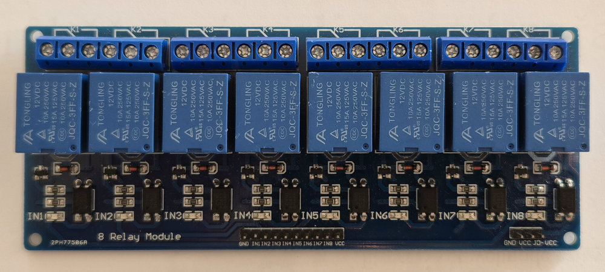

# 8 Relays board

Maps one PIC board connector to an "8 way 12V relay module" with low level trigger.
Only relays 1-6 are used; IN7 and IN8 stay unconnected, which keeps those relays off.
This board is represented by Java class `Relay8BoardDevice`.

Relays are switched on by logical 0 on the input (`highValueMeansOn = false`), so the
outputs are initially set to 1 and all relays start off.

## Parts
* 1x "_5V 12V Low Level Trigger Relay Module 1/2/4/8/16 Channel Optocoupler Isolation Board_" (AliExpress, WAVGAT store), variant "8 WAY 12V Relay"
* 1x [PIC-board](../pic-board/pic-board.md)
* 1x FC-8P connector with a straight cable

## Power

Headers on the board:
```
input header:  GND IN1 IN2 IN3 IN4 IN5 IN6 IN7 IN8 VCC
power header:  GND VCC JD-VCC
```

The relay coils (Tongling JQC-3FF-S-Z, 12VDC) need 12V, the optocoupler inputs are driven by the 5V PIC board.
Remove the `VCC` - `JD-VCC` jumper so the two circuits are separated:

| Relay board                        | Connected to                       |
|------------------------------------|------------------------------------|
| `JD-VCC` (power header)            | +12V of the relay power supply     |
| `GND` (power header, next to JD-VCC) | 0V of the relay power supply     |
| `VCC` (input header)               | PortN.VDD (+5V) of the PIC board   |
| `GND` (input header)               | not connected (keeps isolation)    |

**Warning:** Never connect 12V to the input `VCC`. With the jumper on, the input `VCC` is 12V
and a HIGH output of the PIC (5V) would not switch the relays off reliably.

## Pin mapping

Port pins are numbered 1-6 as I/O pins, i.e. physical connector pins 3-8
(see [PIC-board pin layout](../pic-board/pic-board.md#pin-layout)).

| Relay   | pic board  |
|---------|------------|
| VCC     | PortN.VDD  |
| Relay.1 | PortN.1    |
| Relay.2 | PortN.2    |
| Relay.3 | PortN.3    |
| Relay.4 | PortN.4    |
| Relay.5 | PortN.5    |
| Relay.6 | PortN.6    |
| Relay.7 | -          |
| Relay.8 | -          |
| GND     | -          |

## Photos

